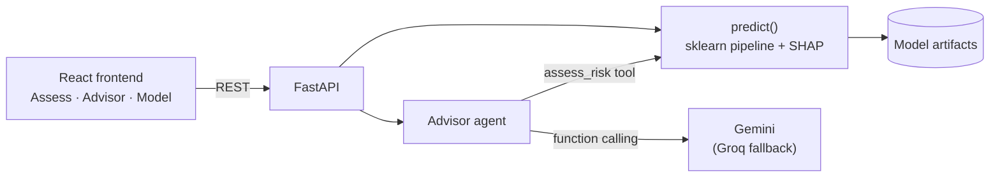

<div align="center">

# CreditLens

**Explainable loan default risk scoring, with an AI advisor that explains each decision.**


[Features](#features) · [Architecture](#architecture) · [Data](#data) · [Model](#model) · [Getting started](#getting-started) · [API](#api)

</div>

---

CreditLens predicts the probability that a loan applicant will default and uses SHAP to break each prediction down by feature. A conversational advisor answers questions such as *"Why is this applicant high risk?"* or *"What if they offered collateral?"*. The advisor calls the model as a tool, so its answers come from real predictions.

The model is trained on synthetic data calibrated to Nepal Rastra Bank (NRB) statistics.


## Features

| Page | What it does |
|---|---|
| **Assess** | Scores a 12-field loan application. Shows the default probability, the risk band, a SHAP chart of every feature's effect, and the top three factors in plain language. |
| **Advisor** | Answers questions about applicants, risk factors and the model. It can use the applicant you just assessed as context. |
| **Model** | Shows the three-model comparison, global feature importance, the test-set confusion matrix, and train vs test metrics. |

Risk bands: **Low** below 30% · **Medium** 30–60% · **High** above 60%.

<table>
  <tr>
    <td width="50%"></td>
    <td width="50%"></td>
  </tr>
  <tr>
    <td align="center"><sub>Model performance and feature importance</sub></td>
    <td align="center"><sub>Advisor chat</sub></td>
  </tr>
</table>

## Architecture



- The trained pipeline and the SHAP explainer load once, at startup.
- `/predict` returns the score, the risk level and the SHAP contribution of every feature.
- The advisor has one tool, `assess_risk`. The tool validates its input against the same schema as `/predict`.
- If Gemini fails, the same request goes to Groq.

## Data

No public applicant-level loan data exists for Nepal. [`generate.py`](backend/data/generate.py) therefore builds 5,000 synthetic applicants, deterministically (seed 42).

| Step | Detail |
|---|---|
| **Anchoring** | NRB figures set the province distribution, the agriculture risk premium and the lending-rate range. Agriculture holds about 3.6× more bad loans than its share of lending. Sources: [`nrb_references.json`](backend/data/nrb_references.json). |
| **Derived features** | Debt-to-income is calculated from income, loan amount, rate, term and existing loans; it is not sampled. The API reuses the same function at prediction time. |
| **Default process** | Defaults are drawn from a logistic model. High debt-to-income, agriculture, no collateral, short credit history and high rates raise risk. Government employment lowers it. The intercept is calibrated to a 10% default rate. |
| **Validation** | `sanity_check()` runs after every generation and asserts the expected correlations. |

Assumptions and the resulting default rates: [METHODOLOGY.md](backend/data/METHODOLOGY.md).

## Model

1. **Split:** stratified 80/20 train/test split.
2. **Preprocess:** scikit-learn `Pipeline` with a `ColumnTransformer`: `StandardScaler` for numeric features, `OneHotEncoder` for categorical ones. It is fitted on training data only.
3. **Compare:** Logistic Regression, SVC and XGBoost, with 5-fold cross-validation.
4. **Tune:** the winner by AUC-ROC is tuned with `RandomizedSearchCV`.
5. **Evaluate:** the tuned model is scored once on the held-out test set, checked for calibration, and explained with SHAP.

| Model | CV AUC-ROC | Test AUC-ROC |
|---|:---:|:---:|
| **Logistic Regression** (selected) | **0.757** | **0.788** |
| XGBoost | 0.695 | – |
| SVC | 0.654 | – |

Train AUC (0.773) and test AUC (0.788) are close, so the model does not overfit. Predicted probabilities track observed default rates. Full metrics and plots are in the [backend README](backend/README.md).

## Getting started

### Prerequisites

- Python 3.11+
- Node.js 20.19+
- A Gemini or Groq API key. Only the advisor needs one.

### Backend

```bash
cd backend
python -m venv .venv
source .venv/bin/activate          # Windows: .venv\Scripts\activate
pip install -r requirements.txt
cp .env.example .env               # add your API keys

python -m data.generate            # generate data/loans.csv
python -m model.train              # train, compare, tune; writes model/artifacts/
uvicorn api.main:app --reload --port 8000
```

Interactive API docs are at <http://localhost:8000/docs>. The `Makefile` wraps the same steps: `make data`, `make train`, `make serve`.

### Frontend

```bash
cd frontend
npm install
npm run dev                        # http://localhost:5173
```

### Checks

```bash
# from backend/
python -m model.predict            # prediction output and risk ordering
python -m agent.agent              # advisor tool validation (offline, no API key)

# from frontend/
npm run lint && npm run build
```

## Configuration

Backend settings go in `backend/.env`:

| Variable | Default | Description |
|---|---|---|
| `GEMINI_API_KEY` | – | Primary LLM provider |
| `GEMINI_MODEL` | `gemini-3.8-flash` | Gemini model name |
| `GROQ_API_KEY` | – | Fallback LLM provider |
| `GROQ_MODEL` | `openai/gpt-oss-120b` | Groq model name |
| `LLM_TIMEOUT_SECONDS` | `60` | Timeout per provider |
| `CORS_ORIGINS` | `http://localhost:3000,http://localhost:5173` | Allowed frontend origins |

The frontend reads `VITE_API_URL` (default `http://localhost:8000`).

## API

Base URL: `http://localhost:8000`. Interactive docs: `/docs`.

| Method | Endpoint | Description |
|---|---|---|
| `GET` | [`/health`](#get-health) | Service status and whether the model is loaded |
| `POST` | [`/predict`](#post-predict) | Score one applicant |
| `GET` | [`/model/info`](#get-modelinfo) | Selected model, metrics, comparison and global importance |
| `POST` | [`/chat`](#post-chat) | Ask the advisor a question |

### `GET /health`

```bash
curl http://localhost:8000/health
```

```json
{ "status": "ok", "model_loaded": true }
```

### `POST /predict`

Scores one applicant. The server calculates debt-to-income from the other fields.

| Field | Type | Constraint |
|---|---|---|
| `age` | int | 18–80 |
| `gender` | string | `M`, `F` |
| `income_monthly` | number | NPR, > 0 |
| `employment_type` | string | `Government`, `Private`, `Self-employed`, `Agriculture` |
| `employment_years` | int | 0–62 |
| `loan_amount` | number | NPR, > 0 |
| `loan_purpose` | string | `Agriculture`, `Business`, `Personal`, `Education`, `Housing` |
| `interest_rate` | number | Annual %, 0–30 |
| `existing_loans` | int | 0–20 |
| `has_collateral` | bool | |
| `credit_history_months` | int | 0–744 |
| `province` | int | 1 Koshi … 7 Sudurpashchim |

```bash
curl -X POST http://localhost:8000/predict \
  -H "Content-Type: application/json" \
  -d '{"age": 28, "gender": "M", "income_monthly": 45000, "employment_type": "Government",
       "employment_years": 5, "loan_amount": 500000, "loan_purpose": "Personal",
       "interest_rate": 12.0, "existing_loans": 1, "has_collateral": false,
       "credit_history_months": 72, "province": 3}'
```

`impact` is the feature's SHAP value in log-odds. A positive value pushes the applicant toward default. `contributions` lists all 13 features, sorted by absolute impact.

```json
{
  "risk_score": 0.0617,
  "risk_level": "LOW",
  "top_factors": [
    { "feature": "employment_type", "impact": -0.9482, "direction": "decreases risk" },
    { "feature": "has_collateral", "impact": 0.4751, "direction": "increases risk" },
    { "feature": "interest_rate", "impact": -0.4002, "direction": "decreases risk" }
  ],
  "contributions": [
    { "feature": "employment_type", "impact": -0.9482, "direction": "decreases risk" },
    { "feature": "has_collateral", "impact": 0.4751, "direction": "increases risk" },
    { "feature": "interest_rate", "impact": -0.4002, "direction": "decreases risk" },
    { "feature": "debt_to_income", "impact": 0.3109, "direction": "increases risk" },
    { "feature": "credit_history_months", "impact": 0.1933, "direction": "increases risk" },
    { "feature": "gender", "impact": 0.0852, "direction": "increases risk" },
    { "feature": "loan_purpose", "impact": 0.0847, "direction": "increases risk" },
    { "feature": "existing_loans", "impact": 0.0306, "direction": "increases risk" },
    { "feature": "employment_years", "impact": -0.0303, "direction": "decreases risk" },
    { "feature": "province", "impact": -0.0188, "direction": "decreases risk" },
    { "feature": "income_monthly", "impact": -0.0139, "direction": "decreases risk" },
    { "feature": "loan_amount", "impact": 0.0, "direction": "decreases risk" },
    { "feature": "age", "impact": 0.0, "direction": "decreases risk" }
  ],
  "debt_to_income": 0.449,
  "explanation": "Low risk. Risk is raised mainly by collateral (none). Risk is lowered by employment type (Government) and interest rate (12%).",
  "model_used": "Logistic Regression (tuned)"
}
```

Invalid input returns `422` with one entry per field:

```json
{
  "detail": [
    { "type": "greater_than_equal", "loc": ["body", "age"], "msg": "Input should be greater than or equal to 18", "input": 15, "ctx": { "ge": 18 } },
    { "type": "less_than_equal", "loc": ["body", "province"], "msg": "Input should be less than or equal to 7", "input": 9, "ctx": { "le": 7 } }
  ]
}
```

### `GET /model/info`

```bash
curl http://localhost:8000/model/info
```

```json
{
  "best_model": "Logistic Regression",
  "best_params": { "C": 0.5414413211338525, "l1_ratio": 1.0, "solver": "liblinear" },
  "cv_auc": 0.7589,
  "train_metrics": { "accuracy": 0.8952, "precision": 0.3804, "recall": 0.1632, "f1": 0.2284, "roc_auc": 0.7725 },
  "test_metrics": { "accuracy": 0.887, "precision": 0.3448, "recall": 0.2105, "f1": 0.2614, "roc_auc": 0.7881 },
  "confusion_matrix": [[867, 38], [75, 20]],
  "comparison": [
    { "model": "Logistic Regression", "accuracy": 0.89, "precision": 0.3381, "recall": 0.1605, "f1": 0.2167, "roc_auc": 0.7572 },
    { "model": "XGBoost", "accuracy": 0.8745, "precision": 0.2055, "recall": 0.1132, "f1": 0.1451, "roc_auc": 0.6949 },
    { "model": "SVC", "accuracy": 0.9005, "precision": 0.16, "recall": 0.0132, "f1": 0.024, "roc_auc": 0.654 }
  ],
  "global_importance": {
    "has_collateral": 0.4751, "interest_rate": 0.4033, "loan_purpose": 0.3103,
    "credit_history_months": 0.2986, "employment_type": 0.2677, "debt_to_income": 0.2648,
    "gender": 0.1088, "existing_loans": 0.101, "province": 0.0852,
    "employment_years": 0.0256, "income_monthly": 0.0182, "loan_amount": 0.0, "age": 0.0
  }
}
```

`confusion_matrix` is `[[true negatives, false positives], [false negatives, true positives]]` on the test set, with applicants flagged at a score of 0.3 or higher.

### `POST /chat`

| Field | Type | Description |
|---|---|---|
| `message` | string | 1–4,000 characters |
| `applicant` | object, optional | Same shape as the `/predict` body |

```bash
curl -X POST http://localhost:8000/chat \
  -H "Content-Type: application/json" \
  -d '{"message": "Which features matter most to the model?"}'
```

```json
{
  "reply": "Based on our training data, the features that matter most to the model (in order of global feature importance) are:\n\n1. **has_collateral** (importance: 0.4751)\n2. **interest_rate** (importance: 0.4033)\n3. **loan_purpose** (importance: 0.3103)\n4. **credit_history_months** (importance: 0.2986)\n5. **employment_type** (importance: 0.2677)\n\nOther features included in the model are debt_to_income, gender, existing_loans, province, employment_years, income_monthly, loan_amount, and age."
}
```

Each message is answered on its own; conversation history is not kept. If the advisor assesses an applicant, the reply ends with *"This is a risk assessment, not a lending decision."*

### Errors

| Status | When |
|---|---|
| `422` | Invalid request body; `detail` lists each field error |
| `502` | The advisor failed unexpectedly |
| `503` | Model artifacts are missing (`/predict`, `/model/info`, `/chat`), or every LLM provider is unavailable (`/chat`) |

## Project structure

```
CreditLens/
├── backend/
│   ├── data/            # synthetic data generator, NRB references, methodology
│   ├── model/           # preprocessing, training, evaluation, SHAP, predict()
│   ├── agent/           # advisor: prompt, assess_risk tool, Gemini/Groq providers
│   ├── api/             # FastAPI app, schemas, routes
│   └── docs/            # model plots
├── frontend/
│   └── src/
│       ├── features/    # assess, chat and model pages
│       ├── components/  # layout and shared UI
│       ├── lib/         # API client, types, labels
│       └── state/       # shared app state
└── docs/screenshots/
```

## Tech stack

| Layer | Tools |
|---|---|
| **Backend** | Python, FastAPI, Pydantic, scikit-learn, XGBoost, SHAP |
| **AI** | Google GenAI SDK (Gemini), Groq SDK |
| **Frontend** | React 19, TypeScript, Vite, Tailwind CSS v4, Recharts, React Router |
